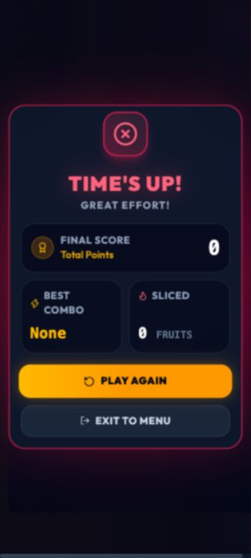

# Fruit Ninja mobile result and exit fixes

Date: 2026-10-06. Base commit: `31ee31c`; verified the current working tree. This follow-up resolves the two Fruit Ninja UI findings in [the nine-game recheck](all-games-recheck.md). Prior uncommitted changes were preserved.

## Changes

- Moved `FruitNinjaOverlays` outside the rotated/clipped Phaser arena. Results stay upright in both practice and multiplayer; the game arena and its touch-coordinate mapping remain unchanged.
- Removed the extra portrait scene Exit to Menu button during active practice play. The shared game wrapper owns the active Exit button. Restart remains available; the finished-game panel retains its exit action.
- Result-screen Exit now requests the existing confirmation without first dismissing the result. Cancel returns to the same result panel. Play Again still clears the result and invokes the existing replay callback; online rematch callbacks are unchanged.

Production files edited in this follow-up: `apps/web/src/games/fruit-ninja/FruitNinjaPhaserGame.tsx` and `apps/web/src/games/fruit-ninja/components/FruitNinjaOverlays.tsx`. Added `FruitNinjaPresentation.test.tsx` with six regressions covering layout/control ownership in portrait/desktop and practice/online modes, result preservation during exit confirmation, and replay delegation.

## Current validation

| Check | Result |
|---|---|
| All discovered web tests | **101/101 PASS**, 12 files, 0 failed, 0 skipped |
| Repository typecheck | **PASS**, 9 workspaces, exit 0 |
| Repository build | **PASS**, exit 0 |
| `git diff --check` | **PASS** |

The existing Vite warning about chunks larger than 500 kB remains. The first typecheck caught a typing issue in the new test's React element inspection; the test typing was corrected and typecheck rerun successfully. No production behavior was changed for that typing correction.

Web tests used the existing local Node/WebSocket Vitest harness and test-only Supabase values. API/engine/multiplayer suites were not rerun for this presentation-only follow-up; their prior **866/866** aggregate in the recheck is historical evidence, not a new run on this edit. No database was accessed. No wallet, authentication, tournament, multiplayer authority or settlement logic was edited.

## Browser verification

An isolated localhost preview used unavailable localhost API/socket endpoints, avoiding production calls.

- At **390×844**, the upright Play Again button occupied x=30…360, y=537.59…584.80. It is fully on screen; before the fix its left edge was −20.80 and the button was rotated.
- At **360×800**, the result actions stayed inside the viewport, document width was 360, and no horizontal overflow was present.
- Active portrait practice had exactly **one visible Exit Game** control. The scene's duplicate exit was absent.
- Result Exit to Menu → confirmation → Cancel preserved the result screen. Active Exit → Cancel stayed on the game route.
- Play Again removed the result and restarted the existing practice flow.
- At **1280×720**, the result remained upright and its replay button fit within the viewport.
- At **844×390**, the result panel scrolled vertically; Exit to Menu remained reachable and opened confirmation.
- Confirmed Exit Game returned to Home, showing All Games (9).

Live two-account multiplayer and physical Android Back remain outside this local verification. No push or deployment was performed.
