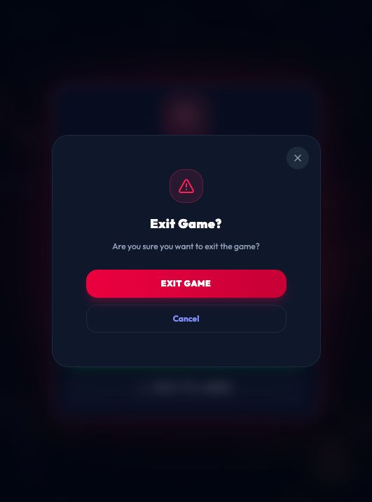

# Finished-game room cleanup and Exit confirmation

Date: 2026-10-08. Baseline: `21e2cdb`, with existing uncommitted tournament work preserved. Verification covers the current local working copy. No push or deployment was performed; no production database was used.

## Why the next search failed

The screenshot's exact error originates in distributed matchmaking when PostgreSQL still records the player in a room. The frontend cleared its local membership before acknowledging the room-leave operation, silently discarded failures, and permitted a new search to overtake cleanup. Late room/match packets could restore departed state; a closure for an old room could clear a newly joined room.

Five new frontend regression cases reproduced these failures before the fix. The client now shares one in-flight leave operation, applies an acknowledgement timeout, keeps failed cleanup available for retry, and gates search/create/join until that cleanup completes. Explicitly searching after a completed game releases the completed room. Departed room/match IDs are bounded to 32 entries and obsolete messages are ignored. Room closures only clear the matching room. Match-found/queue state is cleared with membership.

For older stranded server memberships, distributed matchmaking releases only an authoritative `ended` room through the existing owner-routed leave command. The owner checks `ended` again under its command lock, protecting a concurrent rematch. Waiting, starting, and playing rooms retain the explicit-leave requirement. Cleanup failure still blocks queue creation. No wallet, payout, settlement, or authentication logic was changed for this fix.

## Exit confirmation

The game-route Exit callback already requested confirmation, but its normal modal was rendered inside the animated route layout. Game confirmation now uses a dedicated body portal above fullscreen/results overlays. Other application dialogs keep their existing rendering/layer. Both in-game and result-screen Exit invoke the route's existing confirmation and cleanup; Cancel preserves the game/results. Browser, gesture, and Android native Back remain normal navigation without this popup.

## Verification

| Check | Files | Passed | Failed | Skipped |
|---|---:|---:|---:|---:|
| Entire web suite | 38 | 315/315 | 0 | 0 |
| Entire multiplayer suite | 23 | 313/313 | 0 | 0 |

Included: five new frontend lifecycle cases, eleven completed-room recovery/search gate cases, existing nine-game Exit/Cancel/unmount/duplicate-leave/StrictMode cases, and native Back regressions. Recovery/search tests use fixture PostgreSQL/Redis interfaces; real production services, funds, and wallets were not accessed. Local Socket.IO integration cases also ran as part of the multiplayer suite.

- Repository `npm run typecheck`: PASS across all nine workspaces.
- Final web typecheck after the last state cleanup adjustment: PASS.
- Repository `npm run build`: PASS. Existing large web chunk warnings remain.
- Diff whitespace check with CRLF handling: PASS.
- Browser: isolated localhost Snake vs Worms practice finished normally; shared Exit and result Exit both displayed confirmation. Cancel retained the results; confirmed Exit navigated home. Dummy auth and unavailable local API/socket endpoints prevented production calls.
- Production deployment verified: NO. Web and socket-server must both receive the changes before the live site benefits.

Machine-readable evidence: `game-exit-room-cleanup-results.json`.
